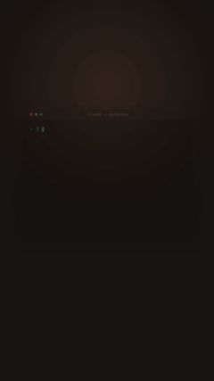

# 🎬 Fábrica de Motion Graphics — Transcrição → Vídeo Pronto

Cole a **transcrição do seu vídeo** no Claude Code e receba, sem responder nenhuma pergunta, um **MP4 vertical (1080×1920) completo** com motion graphics + cada cena renderizada separadamente para montar no seu editor.

Feito para vídeos curtos de redes sociais (Reels, Shorts, TikTok) sobre Claude Code, IA e tecnologia.

## ✨ Exemplos gerados por este projeto

Todos os clipes abaixo foram gerados **automaticamente a partir de uma transcrição real** — o código-fonte de cada cena está em [`src/videos/ultimos-30-dias/`](src/videos/ultimos-30-dias/) e os MP4s completos em [`examples/`](examples/):

<p>
  
  
  
  
</p>

*Da esquerda para a direita: hook de abertura · terminal com 4 buscas paralelas · stat-cards animados · CTA final. Veja o vídeo master completo (1:25) em [`examples/ultimos-30-dias-master.mp4`](examples/ultimos-30-dias-master.mp4).*

## 🧠 Como funciona

```
Transcrição colada no Claude Code
        │
        ▼
┌─ skill transcript-to-motion ──────────────────────────┐
│  Detecta timestamps ou estima tempos (150 palavras/min) │
│  Divide em 3–8 cenas · calcula durações com margem +20% │
│  Escolhe a skill certa para cada cena · aplica regras   │
│  de retenção (movimento constante, cores, hook forte)   │
└──────────────────── brief.md ─────────────────────────┘
        │
        ▼
Cenas em React/Remotion → lint → render automático
        │
        ▼
out/<slug>/master.mp4  +  out/<slug>/clips/*.mp4
```

## 📦 O que vem incluído

**15 skills prontas** em `.claude/skills/`:

| Skill | O que faz |
|---|---|
| `transcript-to-motion` ⭐ | O cérebro: transforma sua transcrição em roteiro de cenas com regras de retenção para vídeo curto |
| `motion-graphics` | Linguagem visual: texto cinético, diagramas, comparações, gráficos |
| `cinematic-camera` | Câmera contínua com keyframes viajando por uma cena única |
| `terminal-inserts` | Demos de terminal/CLI autênticas (Claude Code, agentes, instalações) |
| `article-highlights` | Cards editoriais com marca-texto animado (notícias, releases, estatísticas) |
| `remotion-*` (9 skills) + `mediabunny` | Skills oficiais do time do Remotion: boas práticas, render, legendas, docs etc. |

Mais: `CLAUDE.md` com a pipeline automática configurada, um vídeo de exemplo completo com código-fonte, e as convenções de projeto prontas.

## ✅ Pré-requisitos

1. **Node.js 18 ou superior** — [nodejs.org](https://nodejs.org) (verifique com `node --version`)
2. **Git** — [git-scm.com](https://git-scm.com) (verifique com `git --version`)
3. **Claude Code** — [instruções de instalação](https://docs.anthropic.com/en/docs/claude-code/overview):
   ```bash
   npm install -g @anthropic-ai/claude-code
   ```

## 🚀 Instalação (3 comandos)

```bash
# 1. Clone o projeto
git clone https://github.com/lfelipebessa/motion-transcricao.git
cd motion-transcricao

# 2. Instale as dependências (instala o Remotion junto)
npm install

# 3. Confira que está tudo funcionando (abre o preview no navegador)
npx remotion studio
```

Se o Remotion Studio abriu no navegador mostrando as composições (incluindo `ultimos-30-dias-master`), está pronto. Na primeira renderização o Remotion baixa automaticamente um Chrome headless (~93MB) — é normal e só acontece uma vez.

## 🎥 Como usar

1. Abra o Claude Code **dentro da pasta do projeto**:
   ```bash
   claude
   ```
2. **Cole a transcrição do seu vídeo** — com timestamps (exportada do CapCut, YouTube, Whisper…) ou texto puro, tanto faz:
   ```
   00:00
   Esse repositório faz o seu Claude ficar melhor que o de todo mundo...
   ```
3. É só isso. O Claude vai sozinho: criar o roteiro de cenas (`brief.md`), programar cada cena, e renderizar tudo. Ao final você recebe:
   - `out/<nome-do-video>/master.mp4` — vídeo completo, na duração da sua fala + margem de segurança
   - `out/<nome-do-video>/clips/01-hook.mp4`, `02-*.mp4`… — cada cena separada para montar no seu editor

**Dica de edição:** os clipes marcados como `split-safe` no `brief.md` mantêm o conteúdo importante na metade de cima do quadro — perfeitos para o formato "sua webcam embaixo, graphic em cima".

## 📁 Estrutura do projeto

```
.claude/skills/          ← as 15 skills (o coração do projeto)
CLAUDE.md                ← pipeline automática + convenções (o Claude lê isso sozinho)
src/videos/<slug>/       ← um vídeo = uma pasta
  brief.md               ← roteiro de cenas gerado (leia para entender as decisões)
  Master.tsx             ← sequência completa
  scenes/Scene01Hook.tsx ← uma cena = um componente React
examples/                ← MP4s de exemplo gerados pela pipeline
out/                     ← seus renders saem aqui (fora do git)
```

## 🎨 Personalizando (cores, paletas, estilos)

- **Por vídeo:** cada vídeo tem um `theme.ts` na sua pasta — mude cores/fontes ali e re-renderize.
- **Para sempre:** edite as regras nas skills (`.claude/skills/motion-graphics/SKILL.md` etc.). As skills são arquivos markdown — o que você escrever lá o Claude passa a seguir em todos os próximos vídeos.
- **No pedido:** você também pode simplesmente escrever junto com a transcrição: *"use tons de roxo e dourado"*.

## 🆘 Problemas comuns

| Sintoma | Solução |
|---|---|
| `npm install` falha | Confira `node --version` ≥ 18 |
| Render trava na primeira vez | É o download único do Chrome headless — aguarde |
| `npm run lint` acusa erro após editar cena | Leia a mensagem; o Claude Code corrige se você colar o erro nele |
| Studio não mostra composição nova | Confira se ela foi registrada em `src/Root.tsx` |

## 🙏 Créditos e licenças

- As 4 skills de motion graphics são do repositório [liamrjohnston30/remotion-motion-graphics-skill](https://github.com/liamrjohnston30/remotion-motion-graphics-skill) (MIT) — obrigado, Liam!
- As skills oficiais são de [remotion-dev/skills](https://github.com/remotion-dev/skills).
- **Licença do Remotion:** gratuito para indivíduos e empresas de até 3 pessoas. Empresas maiores precisam de [licença comercial](https://www.remotion.pro/license).
- A skill `transcript-to-motion` e a pipeline automática foram desenvolvidas neste projeto.
